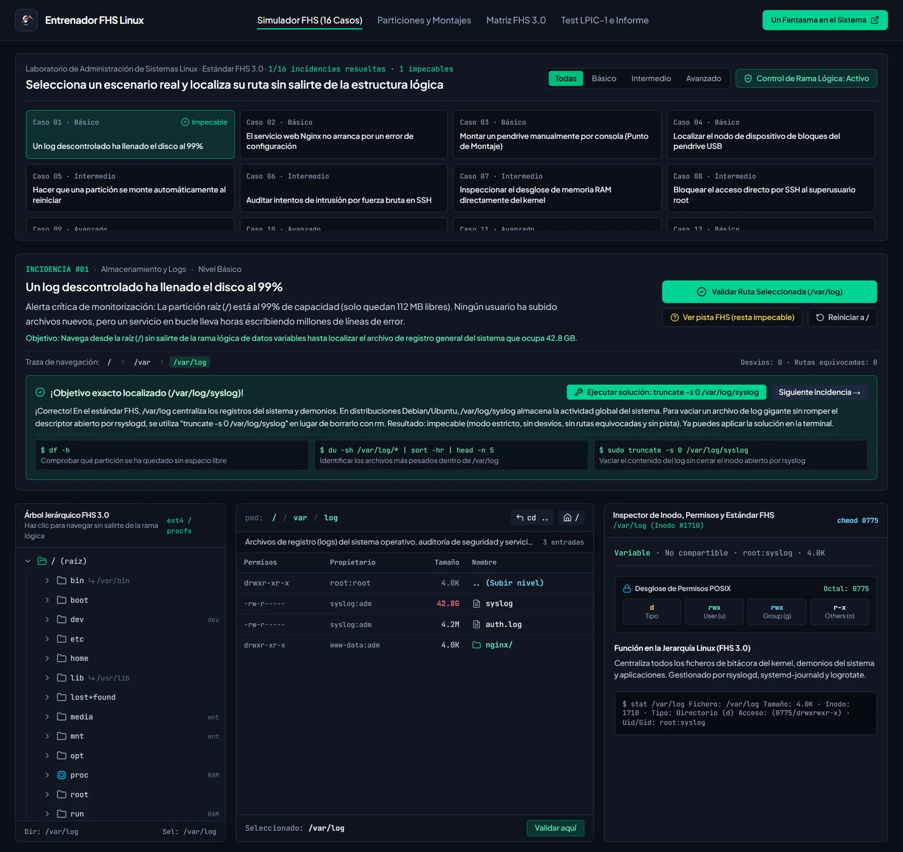
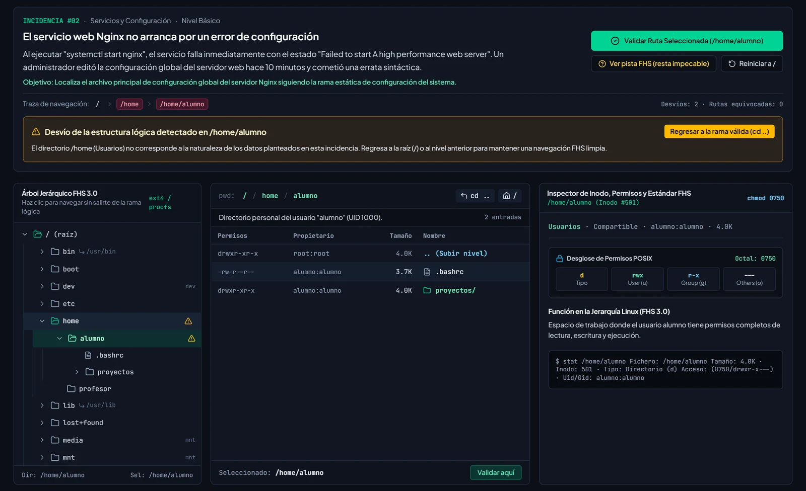
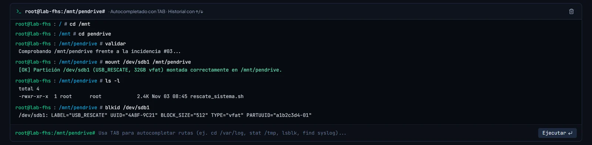
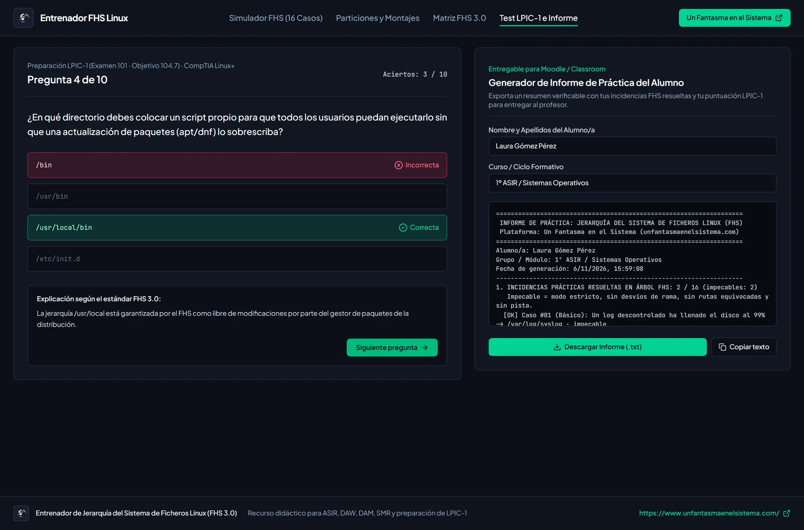
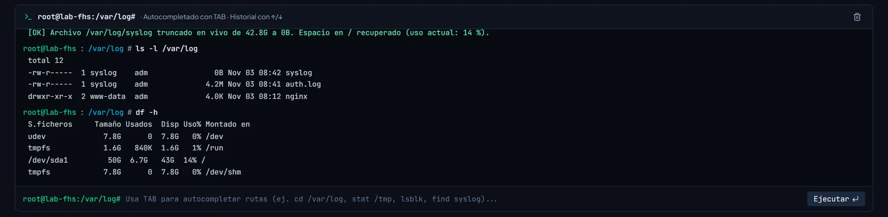
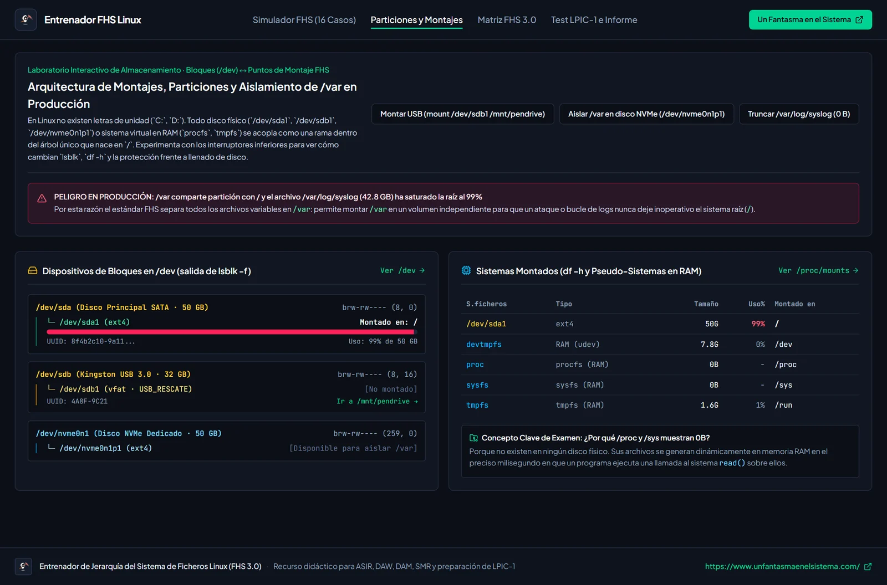
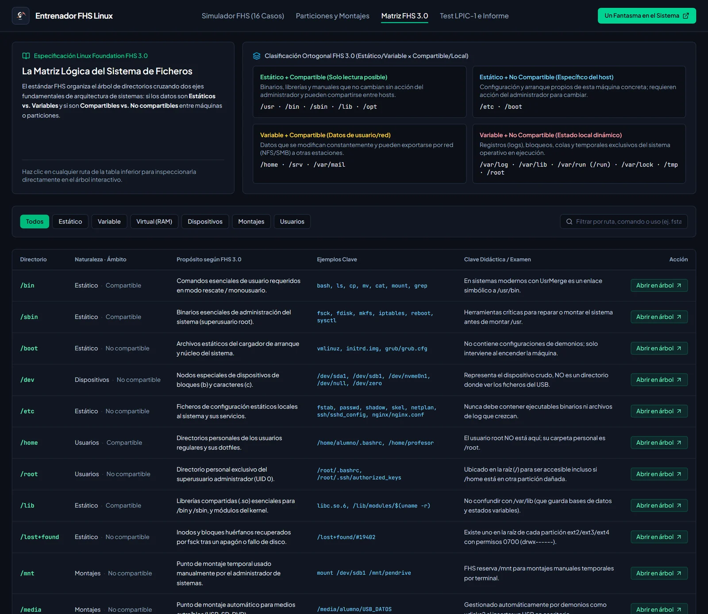
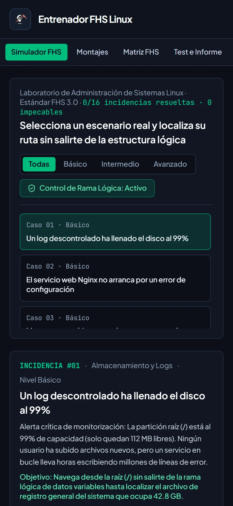

<p align="center">
  <a href="https://www.unfantasmaenelsistema.com"></a>
</p>

<h1 align="center">Entrenador FHS Linux</h1>

<p align="center">
  <b>Aprende la jerarquía de ficheros de Linux resolviendo incidencias reales sin salirte de la rama correcta</b><br>
  16 casos · Árbol FHS 3.0 con inodos y permisos · Terminal root sincronizada · Particiones y montajes · Test LPIC-1 104.7 e informe
</p>

<p align="center">
  <a href="https://unfantasmaenelsistema.github.io/Entrenador-FHS-Linux/"><b>▶ Abrir el entrenador</b></a> ·
  <a href="#qué-hace">Qué hace</a> ·
  <a href="#los-16-casos">Los 16 casos</a> ·
  <a href="#la-terminal">La terminal</a> ·
  <a href="#cómo-se-evalúa">Cómo se evalúa</a> ·
  <a href="#desarrollo">Desarrollo</a> ·
  <a href="https://www.unfantasmaenelsistema.com">unfantasmaenelsistema.com</a> ·
  <a href="LICENSE">MIT</a>
</p>

<p align="center">
  
  
  
  
  
</p>

<p align="center">
  
</p>

Cada caso es una incidencia de un servidor Linux: un log que ha llenado el disco, un Nginx que no arranca, un pendrive que hay que montar a mano, un servicio de systemd con error 203/EXEC… Para resolverla hay que llegar desde `/` hasta el archivo o directorio responsable **sin salirse de la rama lógica** (si el problema es un log, no pintas nada en `/home`). Se puede navegar con el árbol, con el listado o con la terminal, que van sincronizados. Una vez localizado, se aplica la solución en la terminal.

> [!NOTE]
> Todo funciona en el navegador, sin servidor. Solo se guarda en el `localStorage` el mejor resultado de cada caso.

## Qué hace

- **Simulador de incidencias**: 16 casos de nivel básico, intermedio y avanzado. El árbol marca las ramas por las que te has desviado y la traza de navegación queda a la vista.
- **Árbol FHS 3.0 realista**: `/bin`, `/sbin` y `/lib` como enlaces a `/usr` (UsrMerge), `/dev` con discos SATA, NVMe y el pendrive, `/proc` y `/sys` en memoria, `/var`, `/srv`, `/opt`, `/lost+found`… Cada nodo tiene su inodo, propietario, tamaño, permisos y su función según el estándar.
- **Inspector de permisos**: desglose u/g/o, valor octal y bits especiales, incluidos varios a la vez (un `-rwsr-sr-x` es `6755`, SUID + SGID).
- **Terminal root** sincronizada con el árbol: `cd`, `ls -l`, `cat`, `stat`, `file`, `find`, `tree`, `df -h`, `du -sh`, `free -h`, `lsblk`, `blkid`, `mount`, `truncate`, `nginx -t`… con autocompletado de rutas (TAB) e historial (↑/↓).
- **Particiones y montajes**: discos, particiones y puntos de montaje, con lo que muestran `lsblk`, `df -h` y `mount`.
- **Matriz FHS 3.0**: estático/variable × compartible/no compartible, con salto al directorio en el árbol.
- **Test de práctica LPIC-1 (objetivo 104.7)** de 10 preguntas y un **informe para el profesor** con los casos resueltos y cómo se resolvió cada uno; se puede copiar o descargar en .txt.

<p align="center">
  
</p>

## Los 16 casos

| # | Nivel | Incidencia | Dónde está |
|---|---|---|---|
| 01 | Básico | Un log descontrolado ha llenado el disco al 99 % | `/var/log/syslog` |
| 02 | Básico | Nginx no arranca por un error de configuración | `/etc/nginx/nginx.conf` |
| 03 | Básico | Montar un pendrive a mano por consola | `/mnt/pendrive` |
| 04 | Básico | Localizar el dispositivo de bloques del pendrive | `/dev/sdb1` |
| 05 | Intermedio | Que una partición se monte sola al arrancar | `/etc/fstab` |
| 06 | Intermedio | Auditar intentos de fuerza bruta contra SSH | `/var/log/auth.log` |
| 07 | Intermedio | Ver el desglose de la RAM que da el kernel | `/proc/meminfo` |
| 08 | Intermedio | Prohibir el acceso directo de root por SSH | `/etc/ssh/sshd_config` |
| 09 | Avanzado | Un servicio de systemd falla con 203/EXEC | `/etc/systemd/system/webapp.service` |
| 10 | Avanzado | Un script global que el gestor de paquetes no pise | `/usr/local/bin/custom_backup.sh` |
| 11 | Avanzado | Activar el reenvío IPv4 en caliente | `/proc/sys/net/ipv4/ip_forward` |
| 12 | Básico | Alias permanentes solo para el usuario «alumno» | `/home/alumno/.bashrc` |
| 13 | Intermedio | Recuperar un archivo huérfano tras un fsck | `/lost+found/#19402` |
| 14 | Intermedio | La plantilla de los usuarios nuevos de `useradd` | `/etc/skel/.bashrc` |
| 15 | Intermedio | Un temporal que debía sobrevivir al reinicio | `/var/tmp/recuperacion_editor.swp` |
| 16 | Avanzado | Rotar los logs para que no llenen el disco | `/etc/logrotate.d/rsyslog` |

Cada caso trae su explicación, los comandos que se usarían en un servidor real y la orden que lo soluciona (`truncate -s 0 /var/log/syslog`, `mount /dev/sdb1 /mnt/pendrive`, `sysctl -w net.ipv4.ip_forward=1`, `sed … && sshd -t && systemctl reload ssh`…).

## La terminal

La consola es la de **root** (`~` es `/root`) y lee el mismo árbol que el explorador: un `cd` en la terminal mueve el árbol y viceversa.

- `validar` comprueba el directorio actual; `validar <ruta>` comprueba esa ruta (por ejemplo, `validar syslog` dentro de `/var/log`).
- La orden que soluciona el caso **solo funciona después de haberlo localizado**. Antes, la terminal pide que lo encuentres primero. El botón «Cargar comando de solución» tampoco aparece hasta entonces.
- Los comandos tienen efecto: `truncate -s 0 /var/log/syslog` deja el log en 0 B, `mount /dev/sdb1 /mnt/pendrive` hace aparecer su contenido y lo muestra en `lsblk`, `df` y `mount`, y `nginx -t` falla hasta que se corrige la configuración. Al cambiar de caso, el sistema vuelve a su estado inicial.

<p align="center">
  
</p>

## Cómo se evalúa

Un caso se da por resuelto en cuanto se localiza su objetivo, y su resultado se fija en ese momento:

- **Impecable**: con el control de rama lógica activo, sin desvíos, sin validar rutas equivocadas y sin abrir la pista.
- **Resuelto**: en cualquier otro caso, con lo que haya pasado anotado (por ejemplo, «con pista, 2 desvíos» o «1 ruta equivocada»).

Cada desvío y cada validación errónea cuentan, y «Reiniciar a /» no los borra. Una vez localizado el objetivo, explorar ya no penaliza. Si repites un caso, se guarda tu mejor resultado. El progreso de la versión 1 se conserva, marcado como «resuelta (versión anterior)».

El test cuenta la primera respuesta de cada pregunta, y el informe indica si está sin terminar.

<p align="center">
  
</p>

<details>
<summary><b>Más capturas</b></summary>

<p align="center">
  
  <br><br>
  
  <br><br>
  
  <br><br>
  
</p>

</details>

## Desarrollo

Requiere Node.js 20 o superior.

```bash
npm install
npm run dev       # servidor de desarrollo
npm test          # pruebas (Vitest)
npm run lint      # comprobación de tipos
npm run build     # compila en dist/
```

- `src/data/fhsData.ts`: el árbol FHS (inodos, permisos, contenido) y el decodificador de permisos.
- `src/data/missionsData.ts`: los 16 casos y las preguntas del test.
- `src/engine/shell.ts`: el intérprete de la terminal. Devuelve la salida y los efectos (navegar, validar, montar, truncar, solucionar) sin tocar la interfaz.
- `src/engine/missions.ts`: la rama lógica de cada caso, el registro de cada intento y la carga del progreso guardado.

Las pruebas comprueban, entre otras cosas, que el objetivo de cada caso existe y se alcanza desde `/` sin un solo desvío, que ninguna solución funciona antes de localizar el caso y que `mount` o `truncate` no resuelven un caso distinto del suyo.

Cada `push` a `main` publica la web en GitHub Pages con el flujo de `.github/workflows/deploy.yml`, que antes pasa las pruebas y la comprobación de tipos.

## Novedades de la versión 2

- **Se acabó resolver sin buscar**: la orden de solución y su botón solo funcionan después de localizar el caso; antes, el botón «Cargar comando de solución» estaba siempre visible y bastaba con pulsarlo. `mount` y `truncate` ya no resuelven el caso que esté abierto si no es el suyo.
- **Evaluación real**: se anotan desvíos, rutas equivocadas, uso de la pista y modo libre, y se distingue «impecable» de «resuelto». Antes, probar rutas a ciegas no tenía coste y todo caso resuelto contaba igual.
- **Terminal**: intérprete nuevo y probado; `cd` ya no entra en archivos de `/proc` ni lleva `~` a `/home/alumno` siendo root; `cd` a un directorio vacío funciona; `validar <ruta>` sirve para archivos; `blkid <dispositivo>` muestra solo ese; `nginx -t` falla hasta corregir la configuración; `ls -l` con formato real; la salida se desplaza dentro de la terminal sin mover la página.
- **Contenido revisado**: netplan es de Ubuntu (Debian usa `/etc/network/interfaces` o NetworkManager); en Nginx la directiva es `root` (DocumentRoot es de Apache); `uname` no lee `/proc/version`; `/usr` viene de «user»; `/tmp` no siempre se vacía al reiniciar y systemd limpia `/var/tmp` a los 30 días; `/root` es variable y no compartible en la matriz, y se añade `/var/lock`; el montaje permanente va a `/srv/datos` en vez de `/mnt`; la orden de SSH funciona aunque la línea esté comentada, valida con `sshd -t` y avisa de `sshd_config.d`; varios bits especiales a la vez; vfat con `BLOCK_SIZE="512"`; tamaños de disco coherentes.
- El test se presenta como test de práctica (no de certificación) y el informe indica cómo se resolvió cada caso.
- Diseño adaptable sin desbordes de 320 a 1440 px, cabecera con menú compacto por debajo de 1280 px y capturas reales.
- Sin dependencias de servidor, con política de seguridad de contenidos (CSP) y licencia MIT.

## Créditos y licencia

Creado por [Un fantasma en el sistema](https://www.unfantasmaenelsistema.com) como recurso para ASIR, SMR, DAW, DAM y la preparación de LPIC-1. Distribuido con [licencia MIT](LICENSE).
