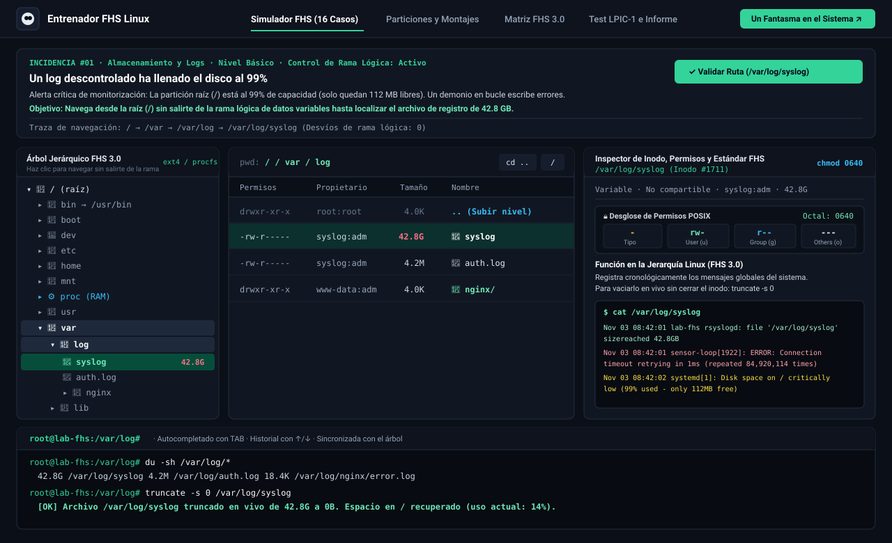
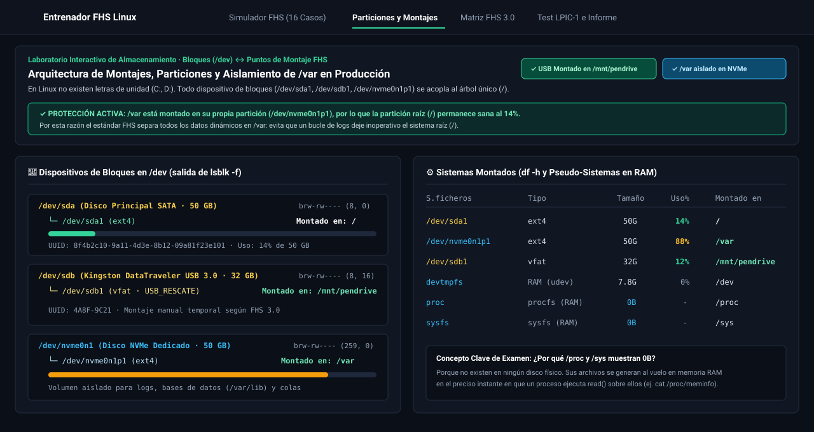
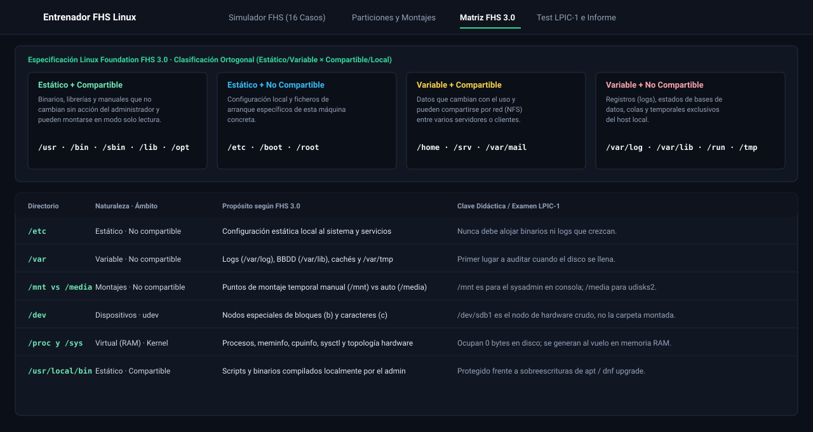
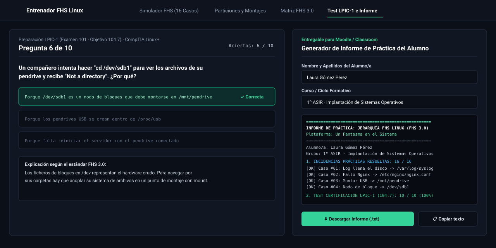

<div align="center">
  <a href="https://www.unfantasmaenelsistema.com/" target="_blank">
    
  </a>

  # Entrenador de Jerarquía del Sistema de Ficheros Linux (FHS 3.0)

  **Simulador interactivo de administración de sistemas Linux, puntos de montaje, permisos POSIX/Octal y preparación LPIC-1**

  [](https://refspecs.linuxfoundation.org/FHS_3.0/fhs/index.html)
  [](https://www.lpi.org/)
  [](#despliegue-en-github-pages)
  [](https://www.unfantasmaenelsistema.com/)

   Creado para estudiantes y docentes de **ASIR, DAW, DAM, SMR, Ciberseguridad y Certificaciones Linux (LPIC-1 / CompTIA Linux+ / LFCS)** por **[Un Fantasma en el Sistema](https://www.unfantasmaenelsistema.com/)**.
</div>

---

## 🎯 ¿Qué hace esta aplicación?

El **Entrenador de Jerarquía del Sistema de Ficheros Linux (FHS 3.0)** recrea de forma realista el árbol de directorios estándar de un servidor GNU/Linux (`/bin`, `/boot`, `/dev`, `/etc`, `/home`, `/lib`, `/lost+found`, `/media`, `/mnt`, `/opt`, `/proc`, `/root`, `/run`, `/sbin`, `/srv`, `/sys`, `/tmp`, `/usr`, `/var`) junto con sus inodos, permisos POSIX/octales, bits especiales (`SUID`, `SGID`, `Sticky Bit`), dispositivos de bloques y ficheros virtuales en memoria RAM.

### Mecánica didáctica
Se plantea al alumno una **incidencia real de administración de sistemas** (por ejemplo: *"un archivo de log ha llenado el disco al 99%"*, *"el servicio Nginx no arranca tras editar su configuración"*, *"montar manualmente un pendrive por consola"*) y el estudiante debe navegar desde la raíz (`/`) hasta localizar el directorio o fichero exacto **sin salirse de la estructura lógica del sistema**.

---

## 📸 Capturas de Pantalla

### 1. Simulador de Incidencias FHS, Inspector de Inodos/Permisos y Terminal Sincronizada


*Vista principal de trabajo en 3 columnas: Árbol Jerárquico FHS 3.0 con detección de desvíos de rama lógica, explorador interactivo `ls -la`, Inspector de Inodo con desglose de permisos POSIX/Octal (`chmod`), previsualización `cat` en vivo y terminal `bash` sincronizada con autocompletado `TAB`.*

---

### 2. Laboratorio Interactivo de Particiones, Bloques (`/dev`) y Puntos de Montaje (`lsblk` / `df -h`)


*Permite acoplar/desmontar en vivo `/dev/sdb1` sobre `/mnt/pendrive`, aislar `/var` en un disco NVMe dedicado (`/dev/nvme0n1p1`) para proteger la partición raíz (`/`) frente a bucles de logs, y comprender por qué `/proc` y `/sys` muestran `0B` en disco.*

---

### 3. Matriz Ortogonal FHS 3.0 (Estático/Variable × Compartible/No compartible)


*Clasificación arquitectónica oficial del estándar FHS 3.0 con buscador instantáneo, ejemplos de comandos y claves de examen para distinguir pares críticos como `/mnt` vs `/media`, `/tmp` vs `/var/tmp`, `/etc/fstab` vs `/proc/mounts` y `/usr/bin` vs `/usr/local/bin`.*

---

### 4. Test de Certificación LPIC-1 (Objetivo 104.7) y Generador de Informe para Moodle / Classroom


*Cuestionario de autoevaluación con retroalimentación inmediata y generador de informe descargable en `.txt` con el nombre del alumno, grupo, casos prácticos superados y nota obtenida.*

---

## 🛠️ Los 16 Casos Reales de Administración Incluidos

| # | Nivel | Categoría | Incidencia Planteada | Ruta Objetivo FHS | Comando de Resolución Real |
| :- | :--- | :--- | :--- | :--- | :--- |
| **01** | Básico | Almacenamiento y Logs | Un log descontrolado ha llenado el disco al 99% (42.8 GB) | `/var/log/syslog` | `truncate -s 0 /var/log/syslog` |
| **02** | Básico | Servicios y Config. | El servicio web Nginx no arranca por una errata sintáctica | `/etc/nginx/nginx.conf` | `nginx -t && systemctl restart nginx` |
| **03** | Básico | Dispositivos y Montaje | Montar un pendrive manualmente por consola (Punto de montaje) | `/mnt/pendrive` | `mount /dev/sdb1 /mnt/pendrive` |
| **04** | Básico | Dispositivos y Montaje | Localizar el nodo de dispositivo de bloques del pendrive USB | `/dev/sdb1` | `blkid /dev/sdb1` |
| **05** | Intermedio | Almacenamiento y Logs | Hacer que una partición se monte automáticamente al reiniciar | `/etc/fstab` | `mount -a && findmnt --verify` |
| **06** | Intermedio | Seguridad y Usuarios | Auditar intentos de intrusión por fuerza bruta en SSH | `/var/log/auth.log` | `grep "Failed password" /var/log/auth.log` |
| **07** | Intermedio | Kernel y Procesos | Inspeccionar el desglose de memoria RAM directamente del kernel | `/proc/meminfo` | `cat /proc/meminfo \| head -n 5` |
| **08** | Intermedio | Seguridad y Usuarios | Bloquear el acceso directo por SSH al superusuario `root` | `/etc/ssh/sshd_config` | `sed -i "s/PermitRootLogin yes/PermitRootLogin no/" /etc/ssh/sshd_config` |
| **09** | Avanzado | Servicios y Config. | Unidad `systemd` propia falla al arrancar con error `203/EXEC` | `/etc/systemd/system/webapp.service` | `systemctl daemon-reload && systemctl restart webapp.service` |
| **10** | Avanzado | Almacenamiento y Logs | Instalar un script global sin que `apt upgrade` lo sobrescriba | `/usr/local/bin/custom_backup.sh` | `chmod 755 /usr/local/bin/custom_backup.sh` |
| **11** | Avanzado | Kernel y Procesos | Activar el enrutamiento IPv4 (`ip_forward`) en caliente en el kernel | `/proc/sys/net/ipv4/ip_forward` | `sysctl -w net.ipv4.ip_forward=1` |
| **12** | Básico | Seguridad y Usuarios | Personalizar alias permanentes solo para el usuario `alumno` | `/home/alumno/.bashrc` | `source /home/alumno/.bashrc` |
| **13** | Intermedio | Almacenamiento y Logs | Recuperar un inodo huérfano tras un apagón brusco y chequeo `fsck` | `/lost+found/#19402` | `file /lost+found/#19402` |
| **14** | Intermedio | Seguridad y Usuarios | Definir la plantilla base para futuros usuarios creados con `useradd -m` | `/etc/skel/.bashrc` | `ls -la /etc/skel` |
| **15** | Intermedio | Almacenamiento y Logs | Recuperar un archivo temporal que debía sobrevivir al reinicio | `/var/tmp/recuperacion_editor.swp` | `ls -la /var/tmp/recuperacion_editor.swp` |
| **16** | Avanzado | Servicios y Config. | Configurar la rotación automática de logs para evitar que llenen el disco | `/etc/logrotate.d/rsyslog` | `logrotate -d /etc/logrotate.d/rsyslog` |

---

## 💻 Comandos Soportados en la Terminal Integrada (`bash`)

La terminal inferior está **bidireccionalmente sincronizada** con el árbol visual y soporta **autocompletado con la tecla `TAB`** e **historial con las flechas `↑` / `↓`**:

- `pwd` — Muestra el directorio de trabajo actual.
- `cd <ruta>` / `cd ..` / `cd /` — Cambia de directorio y actualiza el árbol visual (devuelve `Not a directory` si intentas entrar en un nodo de bloques como `/dev/sdb1`).
- `ls` / `ls -la` — Lista permisos, propietario, tamaño, fecha y enlaces simbólicos.
- `cat <archivo>` — Muestra el contenido real del archivo y lo selecciona en el inspector.
- `stat <ruta>` — Muestra el número de inodo, permisos octales (`0755`, `1777`, `4755`), bits especiales (`SUID` / `Sticky Bit`) y clasificación FHS.
- `find <ruta> -name <patrón>` — Busca archivos o directorios en todo el árbol.
- `tree [ruta]` — Dibuja la estructura de subdirectorios en formato ASCII.
- `df -h` / `du -sh` — Consulta ocupación de particiones y tamaño de los archivos en `/var/log`.
- `free -h` / `lsblk` / `blkid` — Consulta memoria RAM, dispositivos de bloques y UUIDs.
- `mount /dev/sdb1 /mnt/pendrive` — Monta en vivo la partición USB en el punto de montaje temporal.
- `truncate -s 0 /var/log/syslog` — Vacía en caliente el log descontrolado y recupera el espacio en `/`.
- `nginx -t` — Comprueba la sintaxis de `/etc/nginx/nginx.conf`.
- `validar` — Evalúa la ruta actual frente a la incidencia activa.

---

## 🚀 Instalación y Ejecución Local

### Requisitos previos
- **Node.js** 18+ (recomendado Node.js 20 LTS) y **npm**.

### Pasos
```bash
# 1. Clonar el repositorio
git clone https://github.com/TU_USUARIO/entrenador-fhs-linux.git
cd entrenador-fhs-linux

# 2. Instalar dependencias
npm install

# 3. Iniciar servidor de desarrollo (http://localhost:3000)
npm run dev

# 4. Compilar para producción (genera la carpeta ./dist lista para GitHub Pages)
npm run build
```

---

## 🌐 Despliegue en GitHub Pages

El proyecto ya incluye configuración de rutas relativas en Vite (`base: './'` en `vite.config.ts`), archivo `public/.nojekyll` y un flujo de trabajo automático de **GitHub Actions** en `.github/workflows/deploy.yml`.

### Cómo activarlo en tu repositorio de GitHub en 3 clics:
1. Sube este repositorio a tu cuenta de GitHub (`main` o `master`).
2. En tu repositorio de GitHub, ve a **Settings** → **Pages**.
3. En la sección **Build and deployment** → **Source**, selecciona **GitHub Actions**.
4. ¡Listo! Cada vez que hagas `git push`, GitHub compilará la aplicación y la publicará automáticamente en `https://<tu-usuario>.github.io/<nombre-repo>/`.

---

## 📁 Estructura del Proyecto

```text
├── .github/workflows/
│   └── deploy.yml                  # Despliegue automático en GitHub Pages via GitHub Actions
├── docs/screenshots/               # Capturas de pantalla vectoriales para la documentación
│   ├── 01-simulador-incidencias.svg
│   ├── 02-particiones-montajes.svg
│   ├── 03-matriz-fhs.svg
│   └── 04-test-lpic1-informe.svg
├── public/
│   ├── .nojekyll                   # Evita procesamiento Jekyll en GitHub Pages
│   └── assets/aistudio/
│       └── icono_81a3db5b.png      # Logo oficial de Un Fantasma en el Sistema
├── src/
│   ├── components/
│   │   ├── FhsTreePanel.tsx        # Árbol interactivo FHS 3.0 con detección de desvíos
│   │   ├── InteractiveTerminal.tsx # Terminal bash con TAB, historial y comandos reales
│   │   ├── MountSimulatorView.tsx  # Laboratorio interactivo lsblk / df -h / aislamiento /var
│   │   ├── FhsReferenceView.tsx    # Matriz ortogonal FHS 3.0 y buscador de rutas
│   │   └── FhsQuizView.tsx         # Test LPIC-1 (104.7) y generador de informe .txt
│   ├── data/
│   │   ├── fhsData.ts              # Árbol de inodos, contenidos de ficheros y analizador POSIX/Octal
│   │   └── missionsData.ts         # 16 escenarios de administración y banco de preguntas LPIC-1
│   ├── App.tsx                     # aplicación principal y motor de validación de rutas
│   ├── index.css                   # Estilos globales Tailwind CSS v4 y tipografía
│   └── main.tsx                    # Punto de entrada React
├── index.html
├── package.json
├── tsconfig.json
└── vite.config.ts                  # Configurado con base: './' para GitHub Pages
```

---

## 👤 Autoría y Créditos

Desarrollado como recurso educativo abierto para la comunidad de administración de sistemas y ciberseguridad:

- **Web oficial**: [https://www.unfantasmaenelsistema.com/](https://www.unfantasmaenelsistema.com/)
- **Licencia**: Apache-2.0 / MIT — Libre para uso docente en aulas, laboratorios y plataformas educativas citando la fuente original.
